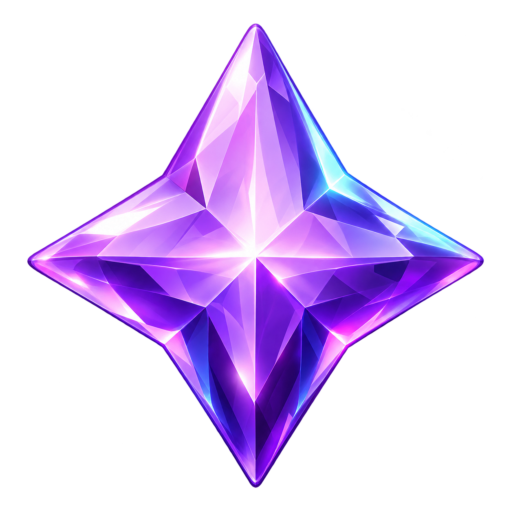
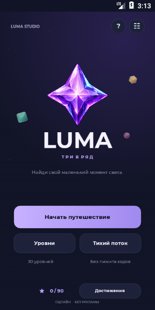
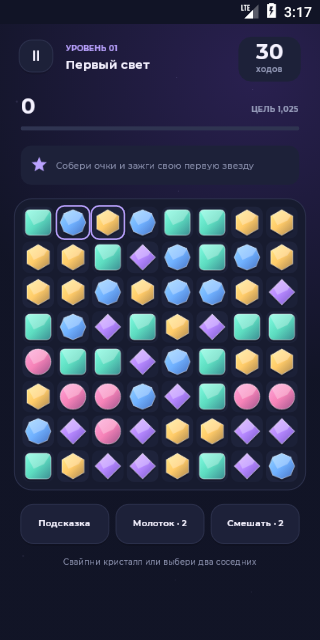

<p align="center">
  
</p>

<h1 align="center">Luma</h1>

<p align="center"><strong>Три в ряд для Android. Найди свой маленький момент света.</strong></p>
<p align="center">C# · .NET 8 for Android · Native Canvas · Android 7.0+</p>

Обменивайте соседние кристаллы, запускайте каскады и открывайте новые уровни.
В Luma есть кампания из 30 уровней и «Тихий поток» — бесконечный режим
без лимита ходов. Игра работает офлайн, без рекламы и покупок.

## Скриншоты

<table>
  <tr>
    <th>Главное меню</th>
    <th>Игровое поле</th>
  </tr>
  <tr>
    <td></td>
    <td></td>
  </tr>
</table>

Реальные снимки приложения из ARMv7-эмулятора Android 7.0.

## Возможности

- **30 уровней** — очки, сбор нужного цвета, разрушение льда и оценка до трёх звёзд.
- **Каскады и комбо** — линейные кристаллы, бомбы, цветные призмы и их сочетания.
- **Тихий поток** — бесконечные ходы и личный рекорд.
- **Подсказки и усилители** — бесплатная подсказка, два молотка и два смешивания на попытку.
- **Прогресс и достижения** — сохранение попытки, рекорды и последовательное открытие уровней.
- **Звук, вибрация и настройки анимации** — настройте игровой отклик под себя.
- **Собственное оформление** — прозрачный PNG-логотип, адаптивная иконка и Montserrat.

## Как играть

Свайпните кристалл или поочерёдно коснитесь двух соседних.
Три одинаковых в горизонтальной или вертикальной линии исчезнут.
Если совпадения нет, обмен отменяется без расхода хода.

| Совпадение | Спецкристалл |
| --- | --- |
| 4 в ряд | Очищает строку или столбец |
| Т / Г из 5 и больше | Бомба, очищающая область 3 × 3 |
| 5 и больше в ряд | Призма, собирающая весь цвет при обмене |
| Две спецфишки | Комбинированный эффект без обычного совпадения |

Выполните все цели до окончания ходов. Победа на последнем ходу засчитывается.
Подробности комбинаций — в [руководстве](docs/GUIDE.md).

## Сборка и установка

Нужны **.NET 8 SDK с workload `android`**, **Android SDK Platform 34** и **JDK 17**.
В подготовленной среде на диске D:

```powershell
git clone https://github.com/reallynigeuteg7-ux/Luma-Project.git
cd Luma-Project
.\build.ps1
```

Для других путей передайте параметры `-Dotnet`, `-AndroidSdk` и `-JavaSdk`
в [скрипт сборки](build.ps1). Подписанный APK появится в соседней папке
`Luma-Android`; скопируйте его на телефон и откройте для установки.
Иконка появится в меню приложений. APK содержит ARM64, ARMv7 и x86-64.

Скрипт создаёт локальный ключ подписи в `Luma-Signing`.
Сохраните этот ключ для обновлений приложения; он не входит в репозиторий.

## Как устроен проект

| Файл | Назначение |
| --- | --- |
| [Game.cs](Game.cs) | Независимые от Android правила, уровни и каскады |
| [LumaView.cs](LumaView.cs), [Screens.cs](Screens.cs) | Canvas-интерфейс, управление и анимации |
| [Profile.cs](Profile.cs) | Локальные сохранения и прогресс |
| [MainActivity.cs](MainActivity.cs) | Жизненный цикл Android-приложения |
| [Sound.cs](Sound.cs) | Звук и вибрация |
| [Tests/](Tests/) | Проверки правил и сохранений без Android |

Во время разработки выполнены 94 055 проверок на 11 444 смоделированных ходах.
Запуск проверок правил:

```powershell
dotnet run --project Tests/Luma.Tests.csproj -c Release
```

APK открывался в Android-эмуляторе; на физическом телефоне пока не проверялся.
Прогресс хранится внутри приложения и удаляется при очистке данных или удалении игры.

**Документация:** [подробное руководство](docs/GUIDE.md) ·
[ассеты и лицензия шрифта](ASSETS.md) · [сведения о версии](RELEASE.md).
